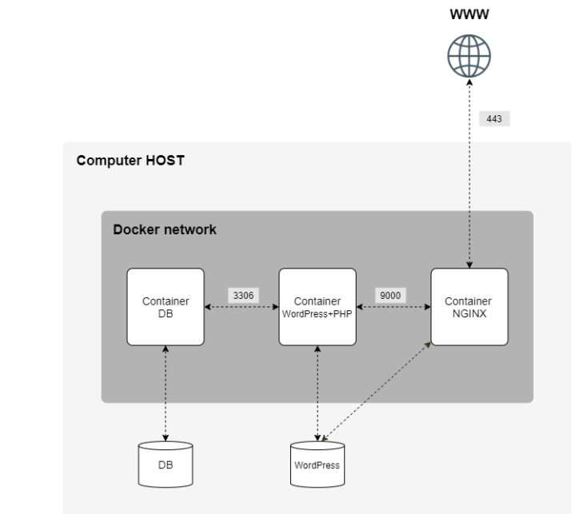

*This project has been created as part of the 42 curriculum by aabi-mou.*

# Outline
1. [Description](#description)
2. [Docker Usage and Design Choices](#docker-usage-and-design-choices)
3. [Virtual Machines vs Docker](#virtual-machines-vs-docker)
4. [Secrets vs Environment Variables](#secrets-vs-environment-variables)
5. [Docker Network vs Host Network](#docker-network-vs-host-network)
6. [Docker Volumes vs Bind Mounts](#docker-volumes-vs-bind-mounts)
7. [Instructions](#instructions)
8. [AI Usage](#ai-usage)
9. [Resources](#resources)


# Description



## Docker Usage and Design Choices
- Linux distibution: Alpine Reason: very small image size compared to Debian.
- Database: MariaDB. A volume is needed to persist data even if container is deleted.
- PHP-FPM (stands for PHP FastCGI Process Manager) is a service that runs PHP code and returns the results to a web server (NGINX here).
- WordPress is a CMS(content management system) that let's anyone build websites without coding knowledge.


## Virtual Machines vs Docker
Both add an abstraction layer between applications and the physical machine, but at different levels.

A virtual machine runs on a **hypervisor**, which splits the host's hardware resources (CPU, memory, storage) between VMs. Each VM boots its own full operating system, with its own kernel, on virtualized hardware. This gives strong isolation, but VMs are heavy: they take up gigabytes and take a while to start.

Docker uses **containerization**: it packages an application and its dependencies into an isolated process that **shares the host's kernel**. A container is created from an **image**, and the image is built from a **Dockerfile**, which is the recipe listing the steps to build it. Containers are lightweight, start in seconds, and behave the same in every environment.

- **Use VMs when** you need full isolation or different operating systems/kernels (e.g. running Windows on a Linux host).
- **Use Docker when** you want lightweight, reproducible services, such as a microservices architecture where each service runs in its own container.

## Secrets vs Environment Variables
**Environment variables** (often loaded from a `.env` file) configure an application: its port, database hostname, debug mode, and so on. They can hold passwords, but that isn't safe. Their values can leak through `docker inspect`, through `/proc/<pid>/environ`, in logs, or to child processes.

**Docker secrets** are the safer way to pass sensitive data such as passwords or API keys. Each secret is stored in its own file and mounted read-only inside the container at `/run/secrets/<name>`, and only the services that ask for it get it. The application reads the value from that file instead of from an environment variable, so it never shows up in the container's configuration.

## Docker Network vs Host Network
On a **Docker (bridge) network**, each container gets its own IP address and network stack, isolated from the host. Containers on the same user-defined network can reach each other by service name through Docker's built-in DNS. To reach a container from outside, you have to publish a port explicitly (`-p host_port:container_port`), and the host then forwards that traffic into the container.

On the **host network**, the container shares the host's network stack directly, with no isolation and no separate IP. Its services listen straight on the host's ports, so port publishing (`-p`) isn't needed and is ignored. This avoids a little overhead but gives up isolation and can cause port conflicts.

## Docker Volumes vs Bind Mounts
Both keep data alive after a container is deleted. The difference is who manages where the data lives.

A **Docker volume** is created and managed by Docker, which stores it in its own area (usually `/var/lib/docker/volumes/`). It's referenced by name, works the same on any host, and is the recommended choice for persistent data such as databases.

A **bind mount** maps a specific path on the host (e.g. `/home/user/data`) straight into the container. It's handy for development or for sharing files with the host, but it depends on the host's directory layout and permissions, which makes it less portable.


# Instructions

### Prerequisites
- Docker Engine with the Docker Compose plugin (Docker Desktop on Windows).
- `make` (Linux VM), used once the Makefile is in place.

### Configuration
1. Copy `srcs/.env.example` to `srcs/.env` and fill in the values (non-secret settings only, `KEY=value` without spaces).
2. Create the `secrets/` folder at the repository root with these files (all ignored by git):

| File | Content |
|---|---|
| `db_password.txt` | Password of `MYSQL_USER`, value only |
| `db_root_password.txt` | MariaDB root password, value only |
| `credentials.txt` | `WP_ADMIN_PASSWORD=...` and `WP_USER_PASSWORD=...`, one per line |

Avoid `'` and `\` in passwords: they are inserted into SQL statements.

### Running the MariaDB service
On the Linux VM, create the data folders once:
```sh
mkdir -p /home/aabi-mou/data/mariadb /home/aabi-mou/data/wordpress
```
On Windows with Docker Desktop, the path is resolved inside Docker Desktop's Linux VM, so create it from a container:
```sh
docker run --rm -v /home:/host-home alpine:3.23 mkdir -p /host-home/aabi-mou/data/mariadb /host-home/aabi-mou/data/wordpress
```
Then, from the repository root:
```sh
docker compose -f srcs/docker-compose.yml up -d --build   # build and start
docker compose -f srcs/docker-compose.yml ps              # wait for "Up (healthy)"
docker logs mariadb                                       # "ready for connections"
docker exec -it mariadb mariadb -u root -p                # SQL shell (root password)
docker compose -f srcs/docker-compose.yml down            # stop, data is kept
```


# AI Usage
AI was used in this project as a learning weapon.
- MariaDB service: Claude Code helped plan the service, write the Dockerfile, config and entrypoint script, and explain each part (build vs run time, PID 1, bootstrap SQL). Every file was reviewed and tested manually before being kept.


# Resources
- Docker docs: https://docs.docker.com/?uuid=93AB6D6A-89CE-4676-A763-4AF0BFD36D9C
- Docker desktop Gordon AI